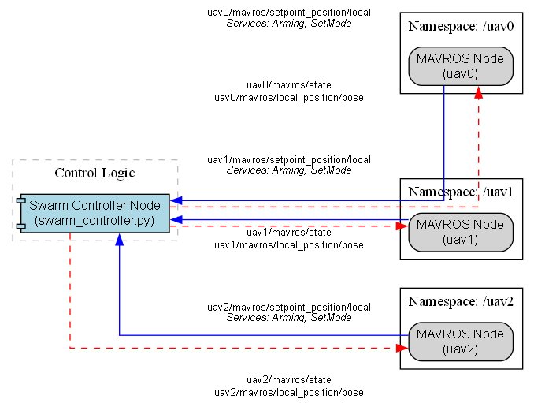
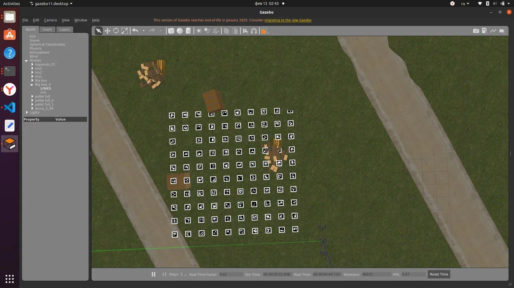
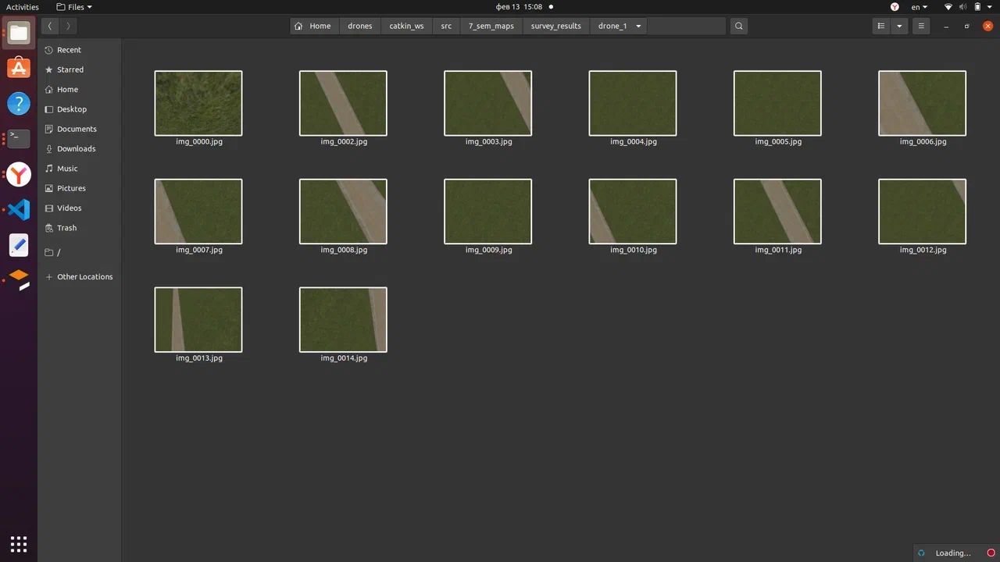
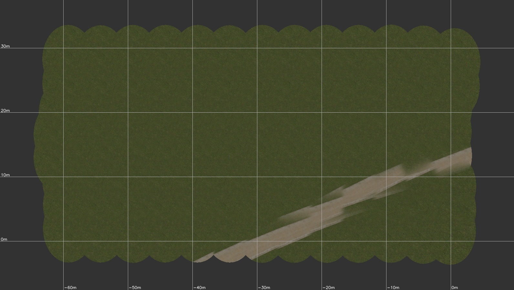

# Multi-Quadcopter Control Practicums

[Русская версия](README.md)

Three university practicums (November 2025 – May 2026) that grew into the bachelor thesis [uav-swarm-formation-control](https://github.com/AlterPath/uav-swarm-formation-control). All of them use three drones in PX4 SITL and Gazebo, controlled through ROS (`rospy`) and MAVROS.

## 6th-semester practicum: leader–follower (`leader-follower/`)

The leader `uav0` flies the route at 5 m, and the followers `uav1` and `uav2` keep fixed offsets from it: (−2, 0) and (−1, −1.5) m. The controller switches the drones to OFFBOARD, arms them and publishes position setpoints. `graph.py` draws the topic and service diagram with graphviz.

<p align="center"></p>

`swarm_control/` holds the first version as a catkin package. `swarm_simulation.launch` brings up three drones through `multi_uav_mavros_sitl.launch` and starts the controller. `swarm_fixed.launch` and `two_drones_fixed.launch` start PX4 SITL, the Gazebo model and MAVROS for each drone separately, with a start delay so that the instances do not get in each other's way.

## ROS link between two computers (`wifi-communication/`)

November 2025. Two computers share one ROS master over Wi-Fi, and `ros_master.sh` sets the master address. `pc2_publisher.py` sends strings from the client to `/pc2_data`, and `pc2_subscriber.py` receives frames from `image_topic` and shows them in an OpenCV window with their size and mean brightness.

## 7th-semester practicum: swarm field survey (`mapping/`)

The user sets the flight altitude and the field length and width. The distance between drones comes from the ground footprint of a frame (2 rad camera field of view) with at least 10% overlap. Three drones fly the field in separate threads and save onboard camera photos.

<table>
  <tr>
    <td></td>
    <td></td>
  </tr>
  <tr>
    <td align="center">The field in Gazebo, top view</td>
    <td align="center">Photos saved by a drone</td>
  </tr>
</table>

## Pre-diploma practicum: an orthophoto from swarm photos (`orthophoto/`)

`build_map.py` builds an orthophoto from the photos of all drones:
1. From each frame's telemetry (position, altitude, angles) it computes the ground footprint with a 114° field of view.
2. It places frames along the drones' lanes. Lane offsets can come from the code or be set manually.
3. It blends overlaps with center-weighted masks and draws a metric grid.

The example below was built from 104 photos of three drones in one thesis experiment run (potential fields with lanes, no obstacles): an 80 × 45 m canvas, 68% covered. At frame seams the road is slightly misaligned, because frames are placed from telemetry alone, without image matching.

<p align="center"></p>

```bash
python3 orthophoto/build_map.py --photos photos_*_uav0_*.csv photos_*_uav1_*.csv photos_*_uav2_*.csv \
    --imgdir raw_images --out mosaic.jpg --grid
```

The photos and telemetry of this run are in the [release](../../releases/tag/orthophoto-sample). The full batch dataset is in the [thesis](https://github.com/AlterPath/uav-swarm-formation-control/releases/tag/experiment-data) release.

Code comments and logs are in Russian.

## Tech stack

Python, ROS (rospy), MAVROS, PX4 SITL, Gazebo, OpenCV, NumPy, pandas, graphviz.

## License

[MIT](LICENSE)

---

<sub>The code was written from November 2025 to May 2026 and published on GitHub in November 2026. Commit dates follow the dates of the original files; the README and figures were added at publication. A leftover `args.demo` check in `orthophoto/build_map.py` was removed at the same time.</sub>
