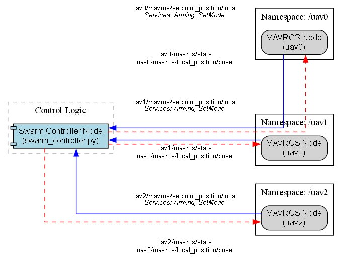
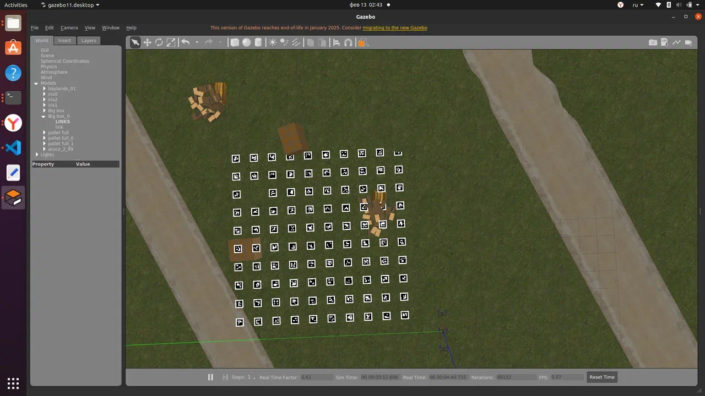
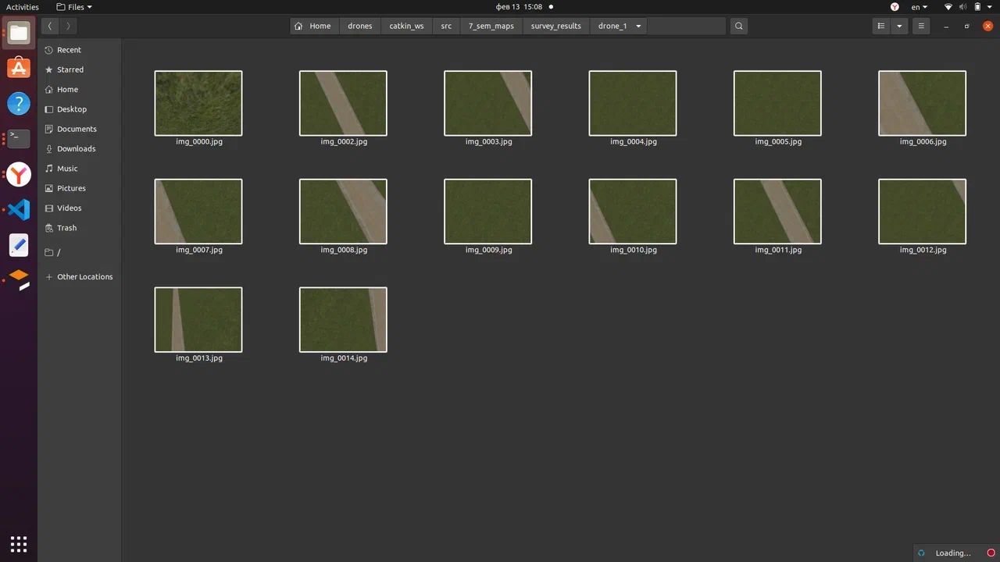
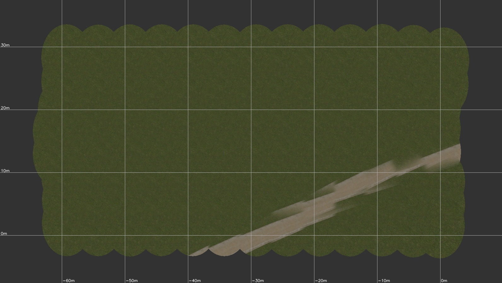

# Практики по групповому управлению квадрокоптерами

[English version](README.en.md)

Три практики (ноябрь 2025 – май 2026), из которых выросла ВКР [uav-swarm-formation-control](https://github.com/AlterPath/uav-swarm-formation-control). Везде три дрона в PX4 SITL и Gazebo, управление через ROS (`rospy`) и MAVROS.

## Практика 6 семестра: «лидер–ведомые» (`leader-follower/`)

Ведущий `uav0` проходит маршрут на высоте 5 м, ведомые `uav1` и `uav2` держат заданные смещения относительно него: (−2; 0) и (−1; −1,5) м. Контроллер сам переводит дроны в OFFBOARD, армит их и публикует уставки позиции. Схему топиков и сервисов строит `graph.py` через graphviz.

<p align="center"></p>

В `swarm_control/` лежит первая версия в виде пакета catkin. `swarm_simulation.launch` поднимает три дрона через `multi_uav_mavros_sitl.launch` и сразу запускает контроллер. `swarm_fixed.launch` и `two_drones_fixed.launch` запускают PX4 SITL, модель в Gazebo и MAVROS для каждого дрона по отдельности, с задержкой старта, чтобы экземпляры не мешали друг другу.

## Связь ROS между двумя компьютерами (`wifi-communication/`)

Ноябрь 2025. Два компьютера работают с общим ROS master по Wi-Fi, адрес мастера задаёт `ros_master.sh`. `pc2_publisher.py` шлёт с клиента строки в `/pc2_data`, а `pc2_subscriber.py` принимает кадры из `image_topic` и показывает их в окне OpenCV вместе с размером и средней яркостью.

## Практика 7 семестра: съёмка поля роем (`mapping/`)

Пользователь задаёт высоту полёта, длину и ширину поля. Расстояние между дронами считается по ширине кадра на земле (угол обзора камеры 2 рад) с перекрытием не меньше 10 %. Три дрона в отдельных потоках облетают поле и сохраняют снимки с бортовой камеры.

<table>
  <tr>
    <td></td>
    <td></td>
  </tr>
  <tr>
    <td align="center">Поле в Gazebo, вид сверху</td>
    <td align="center">Снимки, сохранённые дроном</td>
  </tr>
</table>

## ПДП: ортофотоплан по снимкам группы (`orthophoto/`)

`build_map.py` собирает ортофотоплан из снимков всех дронов:
1. По телеметрии каждого кадра (позиция, высота, углы) вычисляет его отпечаток на земле с учётом угла обзора 114°.
2. Раскладывает кадры по полосам дронов. Смещения полос можно взять из кода или задать вручную.
3. Смешивает перекрытия с весом к центру кадра и рисует сетку в метрах.

Пример ниже собран из 104 снимков трёх дронов в одном прогоне эксперимента ВКР (потенциальные поля с полосами, без препятствий): холст 80 × 45 м, покрыто 68 %. На стыках кадров видно, что дорога слегка расходится. Кадры раскладываются только по телеметрии, без сопоставления изображений.

<p align="center"></p>

```bash
python3 orthophoto/build_map.py --photos photos_*_uav0_*.csv photos_*_uav1_*.csv photos_*_uav2_*.csv \
    --imgdir raw_images --out mosaic.jpg --grid
```

Снимки и телеметрия этого прогона лежат в [релизе](../../releases/tag/orthophoto-sample). Полный набор данных серии лежит в релизе [ВКР](https://github.com/AlterPath/uav-swarm-formation-control/releases/tag/experiment-data).

## Стек

Python, ROS (rospy), MAVROS, PX4 SITL, Gazebo, OpenCV, NumPy, pandas, graphviz.

## Лицензия

[MIT](LICENSE)

---

<sub>Код написан с ноября 2025 по май 2026, на GitHub выложен в ноябре 2026. Даты коммитов взяты по датам исходных файлов, README и иллюстрации добавлены при выгрузке. Тогда же убрана оставшаяся проверка `args.demo` в `orthophoto/build_map.py`.</sub>
